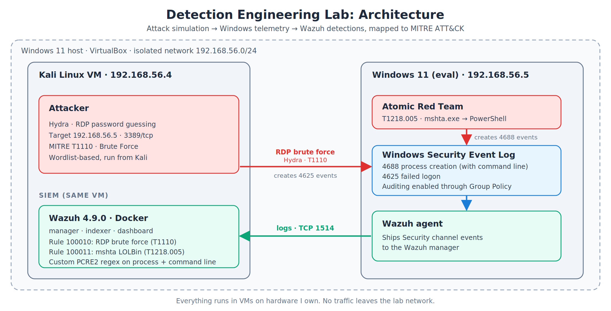
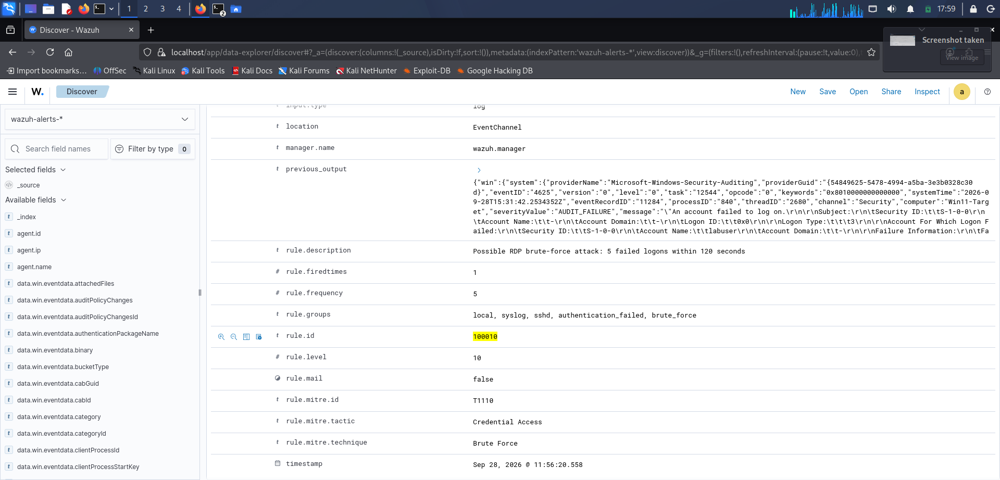
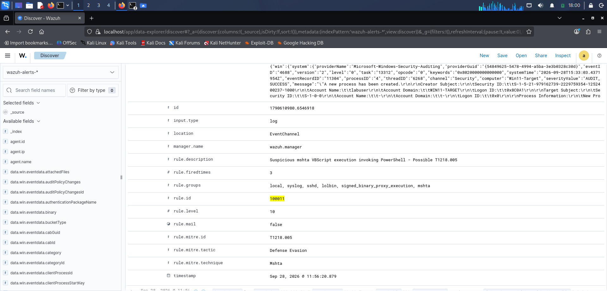

# Detection Engineering Lab: Windows Threat Detection with Wazuh

A home lab where I simulate real attacker techniques against a Windows target and write custom Wazuh detection rules to catch them, mapped to MITRE ATT&CK.



## Overview

Most security projects stop at "I installed a tool." This one goes further: attack → generate real telemetry → write a detection rule from that telemetry → confirm it fires → tune it → document the trade-offs. Every rule below is backed by an actual alert firing in my own lab, not a copied rule from a blog post.

Two MITRE ATT&CK techniques are covered:

| Technique | MITRE ID | Tool used | Event generated | Wazuh rule ID |
|---|---|---|---|---|
| RDP brute force | [T1110 – Brute Force](https://attack.mitre.org/techniques/T1110/) | Hydra | Event ID 4625 (failed logon) | 100010 |
| LOLBin abuse via mshta.exe | [T1218.005 – System Binary Proxy Execution: Mshta](https://attack.mitre.org/techniques/T1218/005/) | Atomic Red Team | Event ID 4688 (process creation) | 100011 |

## Architecture

- **Kali Linux VM** (192.168.56.4) — attacker box, also hosts Wazuh
- **Windows 11 Enterprise Evaluation VM** (192.168.56.5) — target, with advanced audit policy enabled via Group Policy so Event ID 4688 includes full command-line arguments, not just the process name
- Both VMs sit on a VirtualBox **Internal Network** — isolated from the internet and from my home network, so nothing in this lab can reach anything outside itself
- **Wazuh 4.9.0** runs as a three-container Docker stack (manager, indexer, dashboard) on Kali; the Wazuh agent installed on the Windows VM forwards Security log events to the manager over TCP 1514

## Attack simulation

**Brute force (from Kali):**
```bash
hydra -l labuser -P wordlist.txt rdp://192.168.56.5
```
Hydra attempts a list of passwords against the `labuser` account over RDP. Five or more failures in a short window is the exact pattern rule 100010 looks for.

**LOLBin execution (on the Windows VM, PowerShell as Administrator):**
```powershell
Invoke-AtomicTest T1218.005 -TestNumbers 2
```
This runs a scripted Atomic Red Team test that launches `mshta.exe` with a VBScript payload that spawns `powershell.exe` — a "living off the land" pattern where a legitimate, signed Windows binary is abused to launch something else, which is exactly why it's harder to catch than ordinary malware execution.

## Detection rules (`wazuh/local_rules.xml`)

### Rule 100010 — RDP brute force
```xml
<rule id="100010" level="10" frequency="5" timeframe="120">
  <if_matched_sid>60122</if_matched_sid>
  <description>Possible RDP brute-force attack: 5 failed logons within 120 seconds</description>
  <group>authentication_failed,brute_force,</group>
  <mitre>
    <id>T1110</id>
  </mitre>
</rule>
```
`if_matched_sid` references Wazuh's built-in rule for a single Windows failed logon. `frequency="5" timeframe="120"` escalates to this new alert only once that underlying event fires 5 or more times within 120 seconds — a single failed login is normal (typos happen), five in two minutes is not.

### Rule 100011 — MSHTA LOLBin abuse
```xml
<rule id="100011" level="10">
  <if_sid>67027</if_sid>
  <field name="win.eventdata.newProcessName" type="pcre2">mshta\.exe$</field>
  <field name="win.eventdata.commandLine" type="pcre2">(?i)vbscript.*powershell</field>
  <description>Suspicious mshta VBScript execution invoking PowerShell - Possible T1218.005</description>
  <mitre>
    <id>T1218.005</id>
  </mitre>
  <group>lolbin,signed_binary_proxy_execution,mshta,</group>
</rule>
```
My first version of this rule matched on the full file path (`C:\Windows\System32\mshta.exe`) and never fired. Wazuh's `<field>` values are regex, and unescaped backslashes and dots break the match silently — `\W` and `.` mean something different to a regex engine than they do in a plain file path. Rewriting it to match on the binary name (`mshta\.exe$`, with the dot properly escaped) plus a command-line pattern (`vbscript` followed by `powershell`, case-insensitive) both fixed the bug and produced a more meaningful detection, since it's now looking at the actual malicious *behavior* rather than just "mshta ran," which has legitimate enterprise uses too.

## Proof of detection

**Rule 100010 firing — RDP brute force, matched against Event ID 4625:**


**Rule 100011 firing — mshta LOLBin abuse, matched against Event ID 4688:**


Both screenshots show the expanded Wazuh alert fields, including the MITRE ATT&CK mapping (`rule.mitre.id`, `rule.mitre.technique`) generated automatically from the `<mitre>` block in each rule. Additional raw Discover views for both rules are in `screenshots/`, with captions in `screenshots/README.md`.

## Tuning and false positives

- **Brute-force threshold:** set at 5 failed attempts in 120 seconds. A human mistyping a password rarely does it 5 times in two minutes, while Hydra's default throughput clears that in a few seconds. This is a tunable number — a noisier or slower environment might need a shorter timeframe rather than a higher count, to avoid missing a deliberate, slow attacker trying to stay under the radar.
- **LOLBin rule scope:** deliberately not "mshta.exe ran" alone, since that binary has legitimate uses in some enterprise environments (HTA-based internal tools still exist in places). Requiring both `vbscript` and `powershell` in the command line narrows the rule to the actual abuse pattern instead of flagging every mshta invocation.
- **Command-line logging:** Windows doesn't log process command-line arguments by default. Without enabling "Include command line in process creation events" via Group Policy, Event ID 4688 fires but with no way to see *what* actually ran — which would silently break rule 100011 above, since it depends entirely on inspecting the command line. This was the single easiest thing to miss when standing up the logging pipeline, and the first thing I'd check if a similar rule "isn't firing" in a real environment.

## What I'd do differently in production

This lab detects a single event at a time. A real SOC would also baseline what's normal per host or user before alerting — a service account that always runs a specific script shouldn't trip the same rule as a genuine anomaly on a different host. I'd also want to correlate the two detections with each other: a spike of failed logons followed by a LOLBin execution from the same host, close together in time, is a much stronger signal of compromise than either alert on its own. In practice this alert would also route to a tier-1 analyst queue with a documented playbook, rather than "alert fired" being treated as the end state.

## Repo structure

```
.
├── architecture/          diagram source and image
├── wazuh/                 custom Wazuh rules (local_rules.xml)
├── attack-simulation/     exact commands and configuration used for each technique
├── screenshots/           alert triggers, dashboard views, rule-fire confirmations
└── docs/                  extended notes and troubleshooting write-up
```

## Disclaimer

Every VM in this lab runs on hardware I own, on a VirtualBox Internal Network fully isolated from the internet and from my home network. No tool here was ever pointed at anything outside this lab.

## Author

Aditya Kulkarni — M.Sc. IT Security student in Germany. Built this independently as a self-directed project to develop practical SOC and detection engineering skills beyond what's covered in coursework.

www.linkedin.com/in/aditya-kulkarni-a52968221
